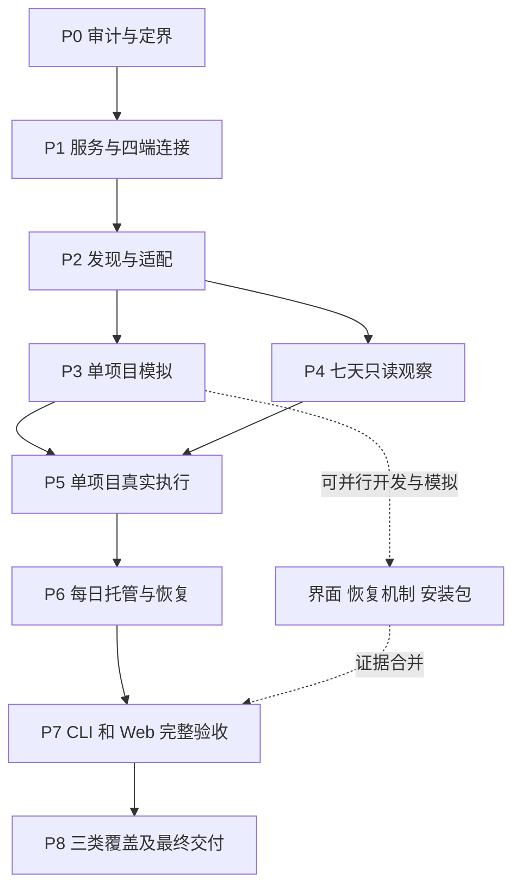

# Codex 分阶段实施计划

> 2026-11-09 最新发现策略：最高优先寻找**已有挖掘公告、主网尚未开挖**的币。发现即重点标记并自动加入开挖待办，**CPU 优先，GPU 其次**；原生 PoW 钱包与币安兼容代币均可跟踪，已交易和币安兼容不再作为发现门槛。见 [开挖待办](docs/LAUNCH_WATCH.md)。此前 USDT/BSC 单次实跑作为历史运行保留，钱包到账与每日调度仍单独验收。

按 P0—P8 完成产品。阶段通过需要可复现证据；不能只因代码已生成而打勾。当前实现与验收进度以 STATUS.md 和 ACCEPTANCE.md 为准，本文保留完整目标和阶段依赖。

2026-11-09 当前交付执行顺序见 [DELIVERY_EXECUTION_PLAN.md](docs/DELIVERY_EXECUTION_PLAN.md)，任务状态见 `docs/delivery-tasks.json`。先补全量线索、通用来源与补抓，再接自动Agent核验、持久通知和端到端验收；当前范围168小时观察、四端原生验收及安装验证完成后签收发现模块。真实运行、三个每日周期和三类路线分别完成原P5—P8门槛。当前任务以任务板为准；不能以计划制定或242项代码测试通过代替这些交付证据。

## 推进流程

读取当前状态 → 选择依赖已满足的最小任务 → 读取相关规格 → 实现 → 运行适当检查 → 复核结果和界面 → 保存证据 → 更新状态 → 进入下一任务。

图中实线表示该阶段完整验收的前提；可提前进行后续阶段不依赖真实执行的开发与模拟。缺失某宿主时，其他模块继续推进，但四端阶段只能标为部分完成，正式版本仍需补齐。

2026-11-06 调整：按用户继续推进缺项的授权，P3 项目准备与 P4 采集可靠性观察并行，避免等项目配方完成才开始累积自然时间；P5 同时依赖 P3 与 P4 完整通过。未降低观察时间、覆盖率、项目适配或授权要求。冻结范围见 docs/OBSERVATION_PLAN.md。

每阶段按以下统一流程收尾：记录变更文件、运行命令/环境/结果、证据位置和剩余风险；更新验收状态；给出下一条可执行动作。普通开发不逐阶段请求许可。真实参与计划需要用户的项目级范围授权，已授权部分不重复询问。

## P0 现有工程审计与边界

目标：选定唯一代码工作区、复用方案和真实兼容范围。

执行步骤：
1. 读取既有 mining-radar、mining-radar-site 的本地规则、README、入口、数据格式、依赖和相关测试。检查 Git/未提交修改，不覆盖用户改动。
2. 只读核实旧服务、巡检/自动化、端口和数据路径；记录未知项。不得读取或输出密钥。能找到旧调度时记录其身份及停用/恢复方式，不立即切换。
3. 核实四种 agent 的安装版本和插件接口。建立“已安装／未安装／配置待信任／已实测”等兼容矩阵，保留来源与核验日期。
4. 运行适当基线检查，决定复用或新建模块。把选型、数据迁移、职责、目录和回滚方案写入 docs/DECISIONS.md。
5. 将本企划纳入选定工程，合并 AGENTS.md；建立实际构建、测试、启动、停止命令表。尚未存在的命令保持“计划”，不要宣称能运行。

产物：环境报告、兼容矩阵、基线测试记录、复用决策、唯一工作区位置。

通过条件：能够说明已有能力与缺口，所有支持结论有证据；数据与调度迁移方式明确。审计旧代码失败时记录失败并确定处理路径，不靠重写掩盖未知。

## P1 共享服务与四端薄适配

目标：任一已启用宿主连接同一个可靠服务。

执行步骤：
1. 建立状态库、版本化 API/IPC、服务生命周期、健康检查、用户级单实例锁、配置和基本状态命令。先提供最小可读界面。
2. 实现 Codex 适配并实测启动/恢复；基于同一协议实现 Claude Code、pi 和 DeepSeek Harness 适配，配置格式分别核实。
3. 集成安装、启用、信任、升级、禁用流程。按进程/会话入口测试，服务启动失败不拖住宿主。
4. 测试多宿主同时启动、子 agent、异常退出、过期锁和端口冲突。验证退出宿主后是否按用户配置继续工作。

产物：服务、四端适配器、实际命令表、连接日志和兼容矩阵。

通过条件：四端分别完成真实连接；并发启动保持一个服务；启动路径无模型调用。测量额外启动延迟，初始设计目标热连接 p95≤500ms、冷唤醒返回≤2s；若本机未达标，提交实测和原因，不修改测试来掩盖。

失败处理：缺客户端可先完成其他实现并标记待实测；不能以静态 manifest 或 mock 连接替代该宿主通过。

## P2 机会发现与本机适配

2026-11-07按用户要求调整：安全通过即可形成尝试建议，硬件、维护和费用单独提示；下文硬件条件仅约束实际运行准备，不再约束尝试推荐。模型设置与配置留痕见docs/TRIAL_POLICY_AND_MODELS.md。

目标：真实来源进入可解释的候选列表。

执行步骤：
1. 建立三类活动、项目身份、证据、交易/奖励状态与来源健康的数据模型。
2. 接入至少两种来源机制，初始以少量可核验官方来源为范围；连接器配置不能把所有未来项目写死。实现游标、缓存、去重、限流和陈旧标记。
3. 实现本机档案和一次性用户偏好设置；硬性不兼容用规则，未知价格与奖励保留未知。
4. 建立事件驱动研究队列、模型用量账本与预算控制。未配置模型时以只读规则模式运行，不能借宿主凭据绕过配置。
5. 建立固定回归集：同名代币、仅盘前交易、DEX 已交易、积分未发币、来源冲突、源站失败、参与结束等至少 20 个标注案例。

产物：真实候选数据、证据详情、适配理由、来源健康页、研究队列和预算统计。

通过条件：关键分类反例全过；重复输入不产生重复项目或模型任务；100 个无变化测试周期新增模型调用为零。硬件不满足的项目不进入可运行队列。

失败处理：不完整证据进入待核验；源站失败不等于没有机会。误报较多时先改来源和规则，不靠扩大提示词反复分析所有项目。

## P3 单项目模拟闭环

目标：得到第一个可演示的端到端切片。

执行步骤：
1. 从 P2 的候选中按官方资料、资源要求、可验证结果和维护负担选一个类别及项目，记录选择理由与未解决项。
2. 实现配方格式、计划生成、范围策略、状态机、幂等键、检查点和成果探针。
3. 实现无外部副作用的 dry-run；下载/安装/提交/签名/付款/领取等执行动作由明确标记的测试替身或隔离环境承担。
4. 注入缺依赖、网络失败、重复请求和验证失败，检查停留步骤与恢复动作。
5. 用代表性“运行中的项目”页面和 CLI 显示这条流程，界面中的模拟结果显著标识。

产物：首个配方、参与计划、模拟证据、失败恢复演示及首张界面。

通过条件：发现→适配→计划→模拟执行→核验→记录可复现；模拟不产生真实安装、签名或资金动作；失败不会固定打印成功。

到此形成首个 alpha 演示节点。整理结果后继续推进可完成的下一阶段，不把 alpha 作为全部项目完成。

## P4 七天真实只读观察

目标：用真实运行判断数据质量与运维负担。

执行步骤：
1. 确认观察计划及新旧巡检不会重复；使用受限来源和明确的运行窗口启动只读监测。该模式不参与项目、不运行矿工、不提交链上操作。
2. 保存真实起止时间、时区 Asia/Shanghai、服务运行窗口、每次计划与实际检查、错误、事件和模型 usage。
3. 连续观察至少 168 小时。每天保存实际报告，无变化不反复提醒。关机、休眠和网络中断如实计入覆盖缺口。
4. 对实际候选进行人工或独立复核，记录可复核数量、错误分类和已知遗漏。样本不足就说明，不声称全网召回率。
5. 检查检测延迟、来源健康、资源消耗、预算和人工介入次数，决定是否通过或延长观察。

产物：7 天报告、扫描账本、抽查记录、缺口与修正清单。

通过条件：真实时间≥168小时；用户设定运行窗口内计划检查成功率初始目标≥95%；无变化周期零新增模型调用；关键错误分类清零后回归通过。目标变化必须事前记录原因，不能事后降低门槛把失败变成功。

失败处理：缺日志或未满时间保持 OBSERVING；固定数据回放和加速时钟只验证逻辑。修复后延长或重启必要观察窗口，并记录原因。

等待期间可开发 P6 恢复模拟、P7 界面和安装文档。跨会话依赖持久服务与状态文件，不依赖聊天一直打开，也不将观察阶段重新包装成每日大模型巡检。

## P5 单项目授权真实执行

目标：一类活动的一条真实参与路线经过验证。

前提：P4 质量通过、目标项目仍开放、本机适配通过，以及具体参与计划获授权。

执行步骤：
1. 实时复查来源、版本、资格、窗口和成本，形成具体参与计划及范围策略。
   在该计划中锁定交付物与验证证据：份额、贡献、积分/任务回执或资产到账。不得在验收失败后更换交付定义。
2. 在授权范围执行准备、部署、运行和健康检查。首次真实运行先用限定资源，确认结果后按策略继续。
3. 用项目或链上证据核验实际贡献/任务结果；领取窗口开放且已授权时领取并核验交付。
4. 验证费用/目标地址变化、策略失效、需要人工验证时只暂停相关步骤，保留恢复点。

产物：实际运行记录、产出核验、授权摘要（不含秘密）、交付证据或等待条件。

通过条件：约定的参与成果可独立核实；有领取/交付步骤的配方需有相应真实证据才完成该步骤。约定交付为贡献或任务回执时，达到条件即可验收，不必等待未知 TGE。若约定资产到账而项目尚未开放奖励，可以完成运行子项，但资金交付保持等待，不能伪造到账。

失败处理：失败后先核实外部状态再重试；只有进程启动不能宣称闭环完成。若该项目没有可达的完整验收路线，可另选合适项目，不静默放宽交付定义。

## P6 每日托管与故障恢复

目标：让已验证流程稳定重复运行。

执行步骤：
1. 将持久调度扩展到真实项目；区分持续服务与每日任务，记录时区、窗口、错过执行、截止时间和重试上限。
2. 加入资源配额、互斥、用户忙碌时降载、费用检查、停止/取消和退出流程。
3. 注入进程崩溃、断网、超时、重启、重复投递和“已提交但未知结果”，核验恢复与幂等。
4. 在已授权项目上观察至少三个真实日调度窗口；持续节点不每日重复启动，领取动作不重复执行。
5. 生成实际日报，记录需要人工介入的次数及原因。

产物：持久日程、故障矩阵、三次真实日调度证据、日报及紧急停止演示。

通过条件：不重复提交/领取/交付；取消后不会自动复活；重启恢复正确；超限按策略停止或降载。加速时钟证明调度逻辑，不替代真实日窗口。

## P7 CLI 和 Web 完整验收

目标：用同一真实状态完成日常操作，并达到明确的视觉质量。

执行步骤：
1. 依据代表页面确定字体、间距、颜色、数字排版和状态组件，保存设计规范。
2. 完成机会列表、详情证据、运行、日程、产出和设置；与 CLI 共用业务 API。
3. 实现键盘操作、窄屏、NO_COLOR/JSON、错误/离线/陈旧等状态，检查中文长名称和实际数据密度。
4. 以 0/5/100 条数据在桌面和窄屏截图；CLI 在 80/120 列检查。独立视觉复核后修复具体问题。
5. 验证本地鉴权、来源检查、状态同步和所有按钮的真实效果。

产物：实际 UI、设计规范、截图/终端快照、交互检查记录。

通过条件：两端状态一致；关键操作与异常路径可用；无溢出、遮挡、不可读文本或静态占位交互。视觉审阅给出具体证据，不能仅写“完美”“高级”。

P0—P7 完成后可以交付 v0.1。它是单类别深执行的个人试用版，不等同于三类完整覆盖。

## P8 扩大覆盖与最终交付

目标：完成最初要求的四宿主与三类活动覆盖。

执行步骤：
1. 为另外两类活动各选择一个合适项目，重复配方验证、模拟、范围授权、真实执行、成果核验及必要的调度观察。
2. 重跑四宿主启动/恢复/并发与工具回归。检查升级兼容、数据迁移和回滚。
3. 在干净或隔离环境验证安装、启用、升级、停止、卸载与数据保留选项；交付运行手册和支持矩阵。
4. 逐项审查 ACCEPTANCE.md，核对实际支持的项目、版本、环境及证据类型。汇总费用、运行资源、人工介入和已知限制。

产物：三类配方目录、四端回归记录、发布包、安装升级卸载说明、验收报告和运行手册。

通过条件：全部强制验收有真实证据；三类各至少一个项目的约定路线完成；没有用 mock、未到期奖励或缺失客户端冒充通过。任何等待真实条件的子项均保留待完成。

## 接续与并行开发规则

每个实现切片尽量只覆盖一个可验证结果。主 agent 负责共享 schema、数据库迁移、依赖锁文件和最终整合；子 agent 可负责边界明确的连接器、适配器、UI 或独立复核，不并发改同一文件。

同一工作区明确文件所有权；确有并行 Git 修改需要时使用隔离 worktree。不要为了每项微小任务新建聊天或工作区。子任务返回变更、运行检查、证据和未解决项，主 agent 必须核查后合并。

STATUS.md 保存工作区、当前版本目标、阶段、具体下一任务、证据入口、命令表、后台进程归属/日志/停止方式和阻塞。上下文不足时先更新状态，再使用接续提示词；不要求新会话盲信旧总结。
