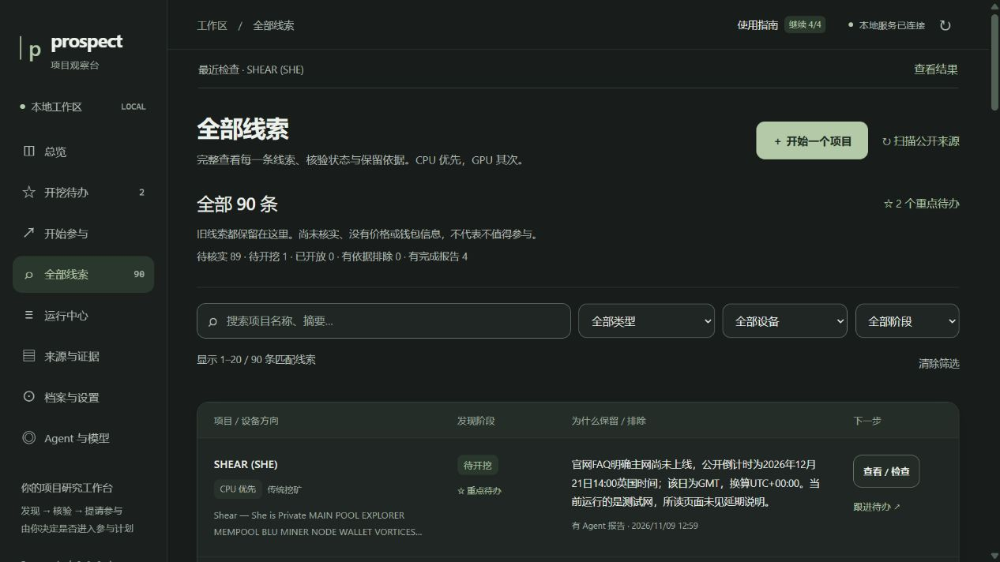
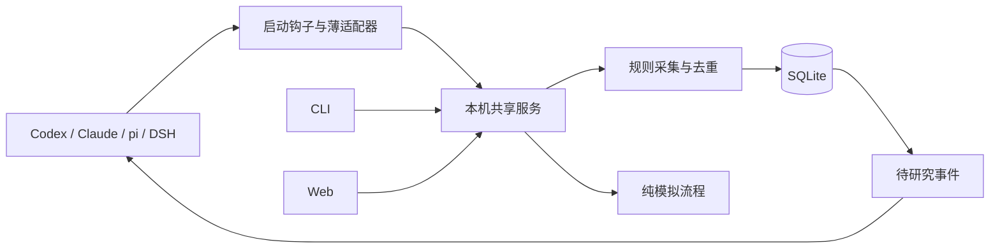

# 寻血猎犬 · Bloodhound

CPU优先的加密项目发现与Agent协作工作台，开发代号 **Prospect**。仓库使用英文路径`bloodhound`；现有Python包、CLI命令和宿主插件标识保留`prospect`。



> 2026-11-09 最新发现策略：最高优先寻找**已有挖掘公告、主网尚未开挖**的币。发现即重点标记并自动加入开挖待办，**CPU 优先，GPU 其次**；原生 PoW 钱包与币安兼容代币均可跟踪，已交易和币安兼容不再作为发现门槛。见 [开挖待办](docs/LAUNCH_WATCH.md)。此前 USDT/BSC 单次实跑作为历史运行保留，钱包到账与每日调度仍单独验收。

本机加密项目观察台与 agent 适配器。当前是 **0.1.0-dev 开发版**：公开来源采集、证据分类、本机条件评估、研究队列、准备模拟、受限进程执行、CLI 和 Web 已接通；尚未达到原企划的 alpha / v0.1 发布门槛。实际进度以 [STATUS.md](STATUS.md) 和 [ACCEPTANCE.md](ACCEPTANCE.md) 为准。

当前工作按 [交付执行计划](docs/DELIVERY_EXECUTION_PLAN.md) 和 `docs/delivery-tasks.json` 逐项推进，先完成找项目的可靠闭环，再完成真实运行、每日托管与原企划验收。

网页入口：**http://127.0.0.1:18766/**。双击本目录的 `Open-Prospect.cmd` 可启动服务并打开网页。关闭页面或 agent 后服务仍保留；停止用 `python -m prospect stop`。

## 已经可用

- 总览与开始参与页顶部显示重点开挖待办；左侧“开挖待办”可查看公告、交给当前 Agent 核对、设为跟进或标为完成。此前 unMineable USDT/BSC CPU 试跑保留在运行记录，不属于新发现的未开挖机会。
- 左侧“全部线索”可搜索、分页及按阶段/类别/CPU-GPU查看全部记录和保留依据；旧72条保留，恢复公告采集后当前共90条。未知不等于排除，有完成的Agent报告不等于安全通过。见[全量目录](docs/LEAD_CATALOGUE.md)及[来源恢复](docs/DISCOVERY_SOURCES.md)。
- 自动核对准确的收款网络/合约、真实市场、矿池账户和固定来源；范围确认、受限启动、真实阶段/算力/份额、停止与回执贯通。当前收入极低，不代表盈利机会。
- “开挖待办”自动接收有挖掘消息、尚未开挖的项目，CPU 优先、GPU 其次。官网 / 公告 / GitHub 规则巡检每 15–30 分钟运行，未知交易价值或钱包兼容性单独标明。已找到 SHEAR 的 CPU 主网预告；日期、来源和状态变更可跟进，待办不授权挖矿。旧七天观察保持暂停、未验收。
- Web 与可交互 CLI 共用同一数据库，柔和深色界面提供四步新手指南，结果页直达本轮日志与回执。模拟、自检与真实挖矿分别标明。
- Codex / Claude Code / pi / DeepSeek Harness 共用 29 工具桥接；自动识别当前调用宿主。报告格式问题可在同一任务内修正补交，保留已知用量；见 [四端共同防护](docs/ALL_AGENT_COMPATIBILITY.md)。接口核验与各原生宿主完整验收分别记录。
- 独立的 Agent 检查、模型与思考强度设置、DeepSeek API 接入仍可使用；项目执行循环不依赖反复调用大模型。历史研究与准备方案折叠保留。

使用与限制见 [单次真实挖矿](docs/REAL_MINING.md)、[执行后端](docs/EXECUTION_BACKEND.md)、[Agent 检查](docs/AGENT_CHECKS.md)。

## 本机安装状态

Codex 和 Claude Code 本地 marketplace 插件已安装并启用，pi 扩展已放入全局自动发现目录。三端安装包已更新为29个工具，四端最新生成包位于 `adapters/prepared-v13/`；已运行聊天可能需重新加载才发现新增工具。Codex 真实报告已通过；Claude 的版本与必要参数已核对，成功生成仍未验证。pi 与 DeepSeek 已有真实 SDK 接入证据，DeepSeek 完整宿主仍缺失。具体范围见 [检查兼容矩阵](docs/AGENT_CHECKS.md) 与 `docs/host-compatibility.json`，不能宣称四端全自动唤起均已通过。

当前适配器绑定本 checkout 和已安装的 Python 3.12；移动目录需重新生成并通过宿主更新。它不是可任意搬迁的发行包。

GitHub 仓库保存源码、测试和经过审阅的界面截图与测试汇总。克隆不会带入本机数据库、钱包登录、密钥、矿池账户、运行授权或已安装的宿主插件；新机器请按 [运行手册](docs/RUNBOOK.md) 配置，并重新生成适配器。完整本机日志和历史运行回执保留在本地，见 [证据说明](evidence/README.md)。

“开始参与”会根据实际启动或调用 Prospect、且仍在运行的宿主自动识别检查 Agent，普通使用无需手选；临时改用宿主或API可展开“其他检查方式”。四端最新包为 `adapters/prepared-v13/`，已安装Codex/Claude/pi及marketplace共5处已更新。识别依据和未完成验收见 [自动识别 Agent](docs/AUTOMATIC_AGENT.md)。

## 使用

开始页直接显示 CPU / GPU 方向、运行阶段、接受份额、矿池余额和钱包到账状态。本轮已结束，点“查看这轮结果”；点“再运行一轮”先查看并确认新的运行范围。当前仅接通 USDT/BSC 的 CPU 路线，其他项目不会因为检查通过就自动获得执行能力。

推荐策略已改为安全优先：硬件仅作提示，安全通过的条目进入“建议尝试”；资料不足显示待安全核验。左侧新增 **Agent 与模型** 专页，可修改 Codex / Claude 后台检查模型与思考强度，查看每次任务配置。见 [策略与模型设置](docs/TRIAL_POLICY_AND_MODELS.md)。

**DeepSeek API** 已加入同一页面：配置接口地址、加密保存密钥、模型、思考强度和输出上限，测试连接后可在项目检查中选择或设为默认。它独立于 DeepSeek Harness，使用有限公开证据包，不具备完整代码审计能力。见 [DeepSeek 接入说明](docs/DEEPSEEK_API.md)。

现在“参与与运行”首屏显示“我的 Agent 检查”；页首可随时跟进。查看真实阶段、已用时、最后活动与取消入口，完成后直接看结论。详见 [检查进度与交互](docs/LIVE_CHECK_PROGRESS.md)。


网页左侧 **开始参与** 是统一入口：自动核对钱包与通道 → 确认单次范围 → 查看实际运行 → 查看本轮结果。真实日志与回执集中在“运行中心”；Agent 研究和自检默认折叠。需要登录钱包时由用户在币安 App 确认，不自动申请转账、交易或签名权限。

在本目录的 PowerShell 中执行：

```powershell
python -m prospect ensure
python -m prospect dashboard --watch
python -m prospect scan
python -m prospect tool prospect_status '{}'
python -m prospect ui
python -m prospect stop
```

`scan` 遵守来源间隔和退避，不会因为重复点击而持续请求。`status` 输出完整状态，`tool prospect_status` 返回给 agent 的紧凑摘要。候选工具支持 `offset` / `limit` 分页；研究工具仅返回少量待核验任务。

运行数据和本地控制凭据统一位于私有 Prospect 数据目录。此机由忽略提交的 `runtime-location.json` 引用 Codex 包内的实际目录，四端适配器也显式绑定它；`PROSPECT_DATA` 可用于隔离测试。凭据不进入保存库。源码、说明和脱敏证据在本目录，旧项目数据保持原状。

## 结构



`prospect/` 是标准库服务和业务模块；`adapters/` 是四宿主包装；`web/` 是无构建依赖的界面；`tests/` 和 `scripts/` 是验证入口。安装、停止、恢复、卸载及后续推进见 [docs/RUNBOOK.md](docs/RUNBOOK.md)。

Opacra testnet 3 已形成带官方来源的准备方案和版本配方；安全核验尚未完成，当前为待安全核验；设备与维护成本单独提示。已提供 Windows 受限执行器和节点信息探针；真实挖矿成果核验、签名交付与每日真实任务仍待实现和验收。
