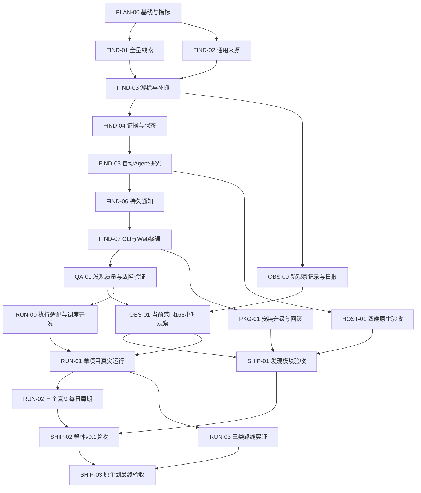

# Prospect 交付执行计划

版本1，制定日期2026-11-09。任务板：`docs/delivery-tasks.json`。依据：`docs/DELIVERY_READINESS.md`及`evidence/delivery-readiness-audit-20261109.json`。这是接下来开发的执行顺序；任务、指标和验证场景均为待执行要求，不表示已经完成。

目标是让用户持续发现“已有挖掘公告、主网尚未开挖”的项目，获得清楚的核验进度和重点提醒，并在具体参与范围获授权后完成运行与成果核验。CPU优先、GPU其次；原生PoW与钱包挂钩代币都可跟踪。钱包兼容、价格、安全审阅、设备适配分别标注，不作为新公告入待办的前置门槛。

原`EXECUTION_PLAN.md`的P0—P8与`ACCEPTANCE.md`的A01—A15继续有效。本计划把当前缺口拆成执行任务，不降低原发布门槛，不把发现模块验收等同于整套产品发布。

## 执行方法

1. 每次接续读README、STATUS、本计划和任务板，从依赖已满足的任务中选下一项；默认单个主任务推进。不重复重写已经可用的后端、界面或适配器。
2. 每个任务先明确输入、输出、失败情形和验收样本，再实现一个可运行切片。接口、迁移和前后端在同一切片接通，用户能看到真实状态。已验证切片可以先更新到本机供用户使用，无需等七天才看到改进；试用状态与正式验收分别标注。
3. 任务依次记录`planned → in_progress → implemented → verified`；确需外部条件时记录`waiting_external`、具体原因及可继续的独立任务。只有验收结果和证据齐全才记verified。
4. 先跑与变更有关的验证，再在模块合并时做完整回归。新增故障、接口或迁移必须有相应验证；不靠增加测试数量证明产品完成。大日志先Headroom压缩并核对stats。
5. 每个任务结束同步任务板、STATUS及验收证据；记录版本、来源范围、配置、样本、指标、后台进程和停止方式。验证失败就保留原失败记录，修复后重验，不在失败后降低指标。
6. 日常可逆开发、只读核对沿已有授权继续。新项目实跑、每日资源使用或资金操作先形成可审阅范围，复用仍有效的授权，只询问真正缺少的范围。旧900秒单次试跑已经结束，不能复用于新一轮或每日运行。

## 顺序和依赖

图中独立任务可交错推进；默认仍由当前Agent逐项执行。自然观察期间可以继续开发安装包、执行适配与调度；真实执行仍遵循原P3/P4前提及项目级范围。原生宿主缺失不阻止其他开发，但会阻止宣称四端全部交付。

## 第一阶段：看得全，找到新公告

| 任务 | 实施内容 | 完成条件 |
| --- | --- | --- |
| PLAN-00 | 保存当前来源、线索、任务、模型偏好及数据库迁移基线；冻结本版指标与证据目录，记录仍缺的宿主/凭据 | 可从基线恢复；来源与模型偏好不会被开发默改；每项指标都有样本和计量定义 |
| FIND-01 | 统一线索阶段、处理状态、证据与排除理由；接全部线索的分页/筛选API和基本查看入口；无损整理旧存档 | 72条旧线索均可查询、数量和ID对得上；未复核写“历史存档，待复核”，不能伪造排除理由；未知、待开挖、已开挖、有依据排除分别显示 |
| FIND-02 | 核对并修复论坛公告源，登记通用公告入口和可扩展官方页跟踪；显示健康、上次成功、下一次尝试和覆盖中断；不绕过访问限制 | 至少两种能持续发现新项目的通用机制真实抓取成功；固定SHEAR官网不计新增发现入口；失败源有明确恢复/替代策略和范围记录，不静默移除失败源美化成功率 |
| FIND-03 | 增量游标、分页、重叠窗口、断档补抓、缓存、限速和去重；对新线索有界读取相关README、Release及公开官方链接 | 新项目不限于首页20条简介；分页/断网/重启/429/304验证通过，补抓无重复任务；保留最后成功游标，失败不前移；区分来源访问成功、条目仍在内容中、Agent核验时间 |
| FIND-04 | 项目身份核对、主网与测试网、未上市与未开挖、日期/时区/延期冲突、CPU/GPU方向分别建模；复核旧线索 | 重名币不误合并；未知不擦除已知；重复轮询不刷新未出现条目的证据新鲜度；符合公告信号先入重点待办，官方核验不足清楚标为待核实 |

来源URL、公开访问方式和支持范围须在FIND-02现场核对后登记，不把未核实的新网站或接口写成已经接入。发现一个新项目时，官网跟踪可先登记为待核对来源；公开HTTPS、重定向、域名及内网访问边界沿现有连接器验证，网页指令不得变成执行命令。

## 第二阶段：自动核实、可靠提醒、清楚操作

| 任务 | 实施内容 | 完成条件 |
| --- | --- | --- |
| FIND-05 | 新公告/重要变化驱动的持久研究队列，复用当前Agent协议和模型设置；手动优先，后台按现有预算准入；证据差分、格式修正及有上限的重试 | 队列→领取→实际阶段→报告→待办更新能跑通；同一证据版本不重复付费研究；无可用宿主、预算或网络时保留待办并显示原因；已知用量不丢失，未知不写0，不自动换模型 |
| FIND-06 | 公告事件到持久通知收件箱；本机系统通知、Web/CLI增量读取；发现、核验完成、延期/撤回和临近开挖分别通知 | 页面关闭且服务运行时能实际提醒；通知有投递/失败/已读记录；服务重启可重试，客户端按事件ID幂等去重；系统接口不支持时如实显示收件箱待送达，不假称推送成功 |
| FIND-07 | 把全部线索、重点待办、当前Agent进度、通知和来源健康接到现有柔和深色CLI/Web；直接呈现下一步及新手说明 | 用户能看懂“发现了什么、查到哪、为什么保留/排除、下一步怎么做”；CPU/GPU明确；检查与实际运行的入口分开且状态真实；桌面、390px、键盘和失败重连验证通过 |

自动研究优先使用真正可调用的当前宿主；Codex/Claude经过版本、参数和认证错误识别后调度。pi/DeepSeek Harness使用正式支持的会话工具，不假设可以从Web凭空唤起宿主。用户已配置启用的API可以按设置使用，不借宿主登录令牌冒充API凭据；无执行通道时排队并解释，不能伪造后台正在工作。

重要公告入待办与最终安全通过是两个事件：先提醒“重要开挖消息，待核实”，官方核验完成后给出“建议准备”的依据。安全、市场价值、钱包及设备信息独立标注；没有依据不能叫确定高收益项目，也不能自动开始矿工。通知使用持久投递加幂等处理，不声称跨系统传输绝对只发生一次。临近提醒默认建议为24小时/1小时，可配置；时间未知或冲突时只提醒待核实，不编造倒计时。

## 第三阶段：证明发现模块可交付

| 任务 | 实施内容 | 完成条件 |
| --- | --- | --- |
| OBS-00 | 新观察run_id、冻结source_plan、历史记录、每日聚合和抽样入口；修复后可启动新范围 | 原暂停观察完整保留；新范围不混入旧计时；关机、暂停、断网、来源变更都留痕；到期只能进入待审阅 |
| QA-01 | 固定标注样本、真实来源抽查、端到端流程、性能/成本和故障矩阵；复用已有测试而非全部重写 | Q1—Q6及Q8的技术验证与计量链路有结果，Q7由OBS-01、四端实机由HOST-01、安装生命周期由PKG-01分别验收；合成、历史回放、真实抓取与实时新发现分别标记。尚未出现合格新公告不阻止开始观察，该项实证留到观察期间补齐，由SHIP-01最终验收，不能用回放替代 |
| HOST-01 | Codex、Claude Code、pi、DeepSeek Harness逐端核对真实版本和正式接口，验证启动、领取、核验、进度、格式修正、取消及恢复 | 四端各有实机记录；SDK加载不代替模型核验或完整宿主；缺完整Harness或账号时记录具体外部条件，继续其他任务，相关发布门槛保持未通过 |
| PKG-01 | 安装、更新、数据迁移、备份回滚、导出恢复、卸载、启动失败与端口冲突；解除发行包对当前绝对目录的依赖 | 在独立临时目录实装；保留无关配置和原数据；自有进程能停止；密钥/凭据不进入保存库、导出包或版本库；当前会话工具需要重载时明确提示 |
| OBS-01 | 在实现稳定后冻结当前有效来源与配置，按届时具体范围开始新168小时只读观察；每日检查覆盖与真实样本 | 原A09：自然时间≥168小时、计划检查成功率≥95%、无变化周期零模型；完成日报与独立抽查。失败须修复后补足证据或建立新范围，保留旧失败与缺口 |
| SHIP-01 | 汇总发现能力、四端和安装证据，签收限定来源范围的发现模块 | 必需任务全部verified；能通过生产连接器发现至少1个未预置真实项目，完成核验、重点待办与实际通知；公布覆盖与限制，不能宣称全市场无漏报；不自动提升整体alpha/v0.1状态 |

观察准备和正式开始分别记录。本计划本身不启动新的长期观察，也不重置原暂停记录。需要用户补登录/首次信任时只处理实际缺口，已经完成的信任不重复索取。

### 冻结的工程验收指标

以下为本版待验证门槛，实施前记录参考机、版本、来源范围、样本和测量方法；变更必须说明理由，不得为掩盖失败降低标准。

| 编号 | 指标与测量范围 |
| --- | --- |
| Q1 数据与规则 | 原有72条记录无损可查；至少30个标注案例，至少20条来自可追溯真实公开资料；覆盖同名币、主网/测试网、已开挖、预告、未上市、日期冲突/延期/撤回、CPU/GPU、未知价格/钱包、恶意链接和源失败。关键错误为0：捏造来源/日期、把测试网当主网、把已开放确认为未开放、未经授权启动。公开样本数与混淆矩阵，不外推全网召回率。 |
| Q2 有界发现能力 | 至少两种通用发现机制真实可用；非预置真实项目至少1个完成采集到通知；冻结样本集中符合条件公告召回率目标≥90%，未知保留为待核实，不用“全丢弃”获得低误报。历史回放只能证明逻辑。 |
| Q3 时效 | 正常来源目标轮询15–30分钟，遵守服务端限流；健康运行时新公告在一个配置周期加2分钟内入库。只对有可核对发布时间/测试投递时间的样本计算；未知不补造。采集结果提交到重点待办≤5秒；系统通知可用时，通知就绪到调用系统投递≤30秒。 |
| Q4 交互 | 本机参考数据集下100次热读取，控制/状态API p95≤500ms，变化到Web显示p95≤3秒；沿原A03记录冷唤醒≤2秒目标。长研究任务提交后立即有真实排队状态，模型未响应不伪造检索进度；长列表与390px无操作遮挡。 |
| Q5 幂等与恢复 | 重复公告、分页重叠、双击、并发领取、进程崩溃、断网、429、304、错误报告、晚到报告、取消和重启分别验证；无重复事实/运行/领取/付款。通知传输允许重试，展示按事件ID去重，保留投递记录。 |
| Q6 运行成本 | 原A07的100个无变化周期新增模型调用为0。自动研究保持现有每日准入预算，手动检查不加本地每日次数上限；预算不足排队不丢公告。固定证据、相同模型配置下比较优化前后用量，目标输入token中位数降低≥50%，同时核验质量不降低；样本不足或宿主用量不可观测则保留未验收。输入、输出、缓存及开发成本分别记录，不把证据包长度当实际总token硬上限。 |
| Q7 连续观察 | 原A09的168自然小时、≥95%计划检查成功率、日报及真实抽查；离线和暂停缺口保留，配置变更不篡改原分母。已知故障源不能静默从冻结计划删除以提高成功率。 |
| Q8 端到端与凭据 | 四宿主真实链路及安装/升级/恢复有证据；研究输出当作不可信资料，来源抓取防内网访问；无任意命令入口，秘密不出私有运行目录。既有授权范围与成果记录升级后保持；检查/待办都不会自动启动项目。 |

## 第四阶段：运行、每日托管、最终交付

| 任务 | 实施内容 | 完成条件 |
| --- | --- | --- |
| RUN-00 | 在既有执行器上开发项目适配契约、固定版本配方、资源限制、停止/恢复与成果探针；开发持久每日调度与互斥，先隔离验证 | 项目步骤不是模型生成的任意shell；缺安全审阅/程序/网络时说明原因；CPU优先；模拟、诊断、真实贡献和资产到账分开。断网、休眠、重复提交、取消后不复活等故障验证通过；开发可在OBS-01期间推进 |
| RUN-01 | 选择已开放且值得验证的CPU项目，核对固定版本、安全范围、资源与交付物，按有效项目授权完成一次真实流程 | 官方认可的份额/贡献/领取回执等实际成果可独立核对；约定资产到账则必须有真实到账证据；新币尚未开放时只记录准备完成，不为等它而阻塞其他可做开发，不假装已运行 |
| RUN-02 | 在单轮成果验证后，按具体每日范围执行三个真实周期，验证限额、时区、重试、错过窗口、重启与紧急停止 | 原A12至少三个真实每日周期完成；每轮资源、费用与成果可查；不重叠、不重复领取/付款；用户暂停后不自动恢复。旧一次900秒授权不覆盖每日运行 |
| RUN-03 | 传统挖矿、节点/算力贡献、测试网/任务三类各完成一条实际路线，GPU在CPU路线后推进 | 原A14三类分别有固定版本、实际参与及项目认可的成果；积分、测试币、未来空投预期与有价资产分开；尚无可用项目或未到窗口则该项保持待验证 |
| SHIP-02 | 按原v0.1门槛检查A01—A13、交付定义、宿主兼容、安装生命周期及每日运行证据 | 全部必需项通过才发布；发现模块或单轮挖矿成功不能替代整体验收；版本、限制、恢复步骤和后台任务交接齐全 |
| SHIP-03 | 按原v1门槛完成A01—A15及最终四宿主回归 | 三类路线与四宿主必需实证齐全；无未解决的交付阻断项；未到发币/领取窗口的资产步骤不能记到账完成 |

只读发现不需要等待某个币正式开挖。真实执行必须选择当前具备验证条件的项目；SHEAR预告跟踪与现有unMineable实跑保留各自含义，不相互替代。用户参与请求、审核通过、运行授权和每日授权分别持久化，防止重试或重启扩大范围。

CPU试跑的推荐范围提案沿用已经实测的上限：最多15分钟、CPU≤20%、内存≤3GB、2线程、GPU关闭；优先空闲时运行。RUN-00按具体项目需求核对预设是否可行，必要调整先写入可审阅范围。这是后续方案的默认起点，不会重新启用旧单次授权或自动打开每日运行。

## 异常与接续规则

- 来源持续失败：保留游标和失败记录，退避并展示覆盖缺口；核对合法备用来源；其他来源继续，不能回报“没有新项目”。
- 模型/宿主不可用：保留公告、队列和已有报告，区分版本、认证、模型权限、网络与格式问题；不无限重试、不静默切换模型、不伪造已在工作。
- 发现结果不符合预期：先定位覆盖缺口、解析、身份、证据或筛选理由，再修改；修复后重放固定样本并做真实抽查，保留前后指标。
- 数据迁移或升级失败：停止自有新任务，保留失败现场，验证备份后恢复；不清空旧线索、授权、钱包配置、来源或旧观察历史来获得“干净状态”。
- 外部条件未满足：任务板记录需要的确切宿主/登录/开放窗口/授权、已完成工作和下一次可做检查；转向依赖已满足的任务，不重复询问已有信息或假装整项完成。
- 长期观察与真实每日周期必须经历自然时间；不占住聊天反复空等，也不使用加速时钟或模拟回执替代。

本版执行起点为PLAN-00，然后推进FIND-01与FIND-02两个可审阅切片。每项验证后继续下一项，不需要用户逐项重新授权普通开发。当前任务与实际完成状态以docs/delivery-tasks.json和STATUS.md为准；计划本身不声明任何执行项已完成。
